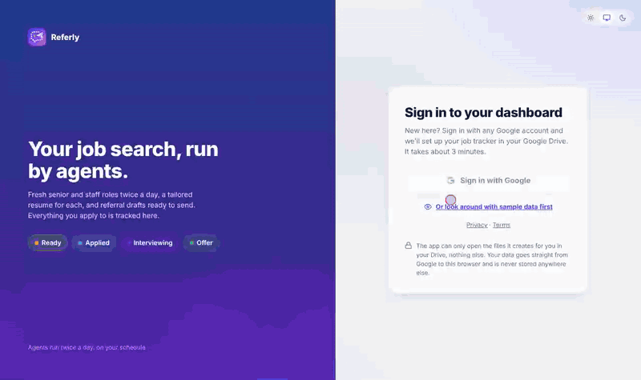

<p align="center"></p>

# Referly

**Try it:** https://github-prathma.github.io/job-dashboard/ (sign in with any Google account, or click **Or look around with sample data first**).



*A one-minute tour using sample data. [Watch the full-quality video (MP4)](docs/demo.mp4).*

A personal dashboard for your job search. It shows the jobs your agents found, a tailored resume for each one, people to contact for a referral, and charts of how your search is going. It also helps you write LinkedIn messages.

**Your data stays in your own Google Drive.** The website holds no data. The first time you sign in, a one-screen setup creates a **Referly** folder in your Drive with everything it needs, including a cleanly formatted copy of your resume. Google only lets the app open the files it created there; it can't see anything else in your Drive.

**Nothing is sent for you.** The dashboard and the agents prepare everything; you apply and send messages yourself.

---

## How it works

```
 Claude agents (run twice a day)          Your Google Drive                     This dashboard
 ─────────────────────────────            ─────────────────                     ──────────────
 1. Find new job postings        ──►   Job Application Tracker (sheet)   ──►   Jobs, charts, "Next up"
 2. Tailor your resume per job   ──►   Tailored Resumes/<Company>/        ──►   Resume buttons
 3. Find people + draft messages ──►   Outreach tab + draft docs          ──►   Agent drafts page
 4. Log the run                  ──►   Runs tab + Run Logs/               ──►   Files and runs page
```


---

## Getting started (about 3 minutes)

No coding, no Google Cloud, no API keys. You need a Google account and your resume as a **PDF or Word (.docx)** file.

### 1. Sign in with Google
Open the site and click **Sign in with Google**, then pick your account. Google asks you to let Referly *"see, edit, create and delete only the specific Google Drive files you use with this app"*. That's the narrowest Drive permission Google offers: the app can only open files it creates for you. Keep that box ticked and click **Continue**.

- Google may show **"Google hasn't verified this app"** the first time. Click **Advanced → Go to github-prathma.github.io**.
- If the sign-in window stays blank or is blocked, click **Sign-in window blank or blocked? Sign in in this tab instead** under the button.
- Just curious? Click **Or look around with sample data first** to explore without signing in.

### 2. Fill in one short screen
New accounts see a single setup form:

| Field | What to do |
|---|---|
| **Signed in as** | Shows the Google account in use. Wrong one? Click **Use a different account**. |
| **First name / Full name** | Already filled in from Google. Use your name as it appears on your resume. |
| **Roles you want** | Comma-separated, e.g. *Senior Software Engineer, Staff Software Engineer*. |
| **Where** | Open the dropdown and tick one or more places (Remote US, Bay Area, Seattle, New York…). Add anything else under **Other**. |
| **Need visa sponsorship?** | **No** or **Yes**. With Yes, you can edit the one line that's added to messages for recruiters only. |
| **Target companies** | Optional. Type to search about 70 companies and click or press Enter to add each as a tag; type any other name and press Enter to add it. Remove a tag with ×. The agents check these companies' job boards every run. |
| **Add your resume** | Upload a **PDF or Word (.docx)** file, up to 5 MB. Other formats (for example old .doc files) are rejected with a message. You can skip this and add it later. |

Click **Create my workspace**.

### 3. Referly builds your workspace
You'll see each step tick off as it's created in your Google Drive:

```
Referly/
├── Job Application Tracker      Google Sheet: Jobs, Outreach, Runs and Profile tabs
├── SEARCH CONFIG (edit me)      Your roles, locations, companies and rules for the agents
├── BASE RESUME - <your name>    Your resume, cleanly formatted (see below)
├── Original resume - <name>     The file you uploaded, untouched
├── Tailored Resumes/            One folder per company, filled by the agents
├── Referral Outreach Drafts/    Message drafts per job, filled by the agents
└── Run Logs/                    One log per agent run
```

**About your resume:** Referly reads your file's sections (name, contact, summary, jobs with dates, bullets, skills, education and more) and rebuilds it as a Google Doc in a clean, consistent layout. It keeps the **same number of pages as your original** (a one-page resume stays one page), choosing the largest font and margins that fit. If your file's structure can't be read, it's imported as-is, and the last screen tells you to check it. Either way, edit the doc any time; the agents always read the latest version.

Your pitch, skills and highlights for LinkedIn messages are filled in automatically from your resume when the agents first run.

### 4. Turn on the agents (recommended)
The agents find new jobs twice a day, tailor your resume for each and draft referral messages. They run in your own [Claude](https://claude.ai) account as a scheduled task:

1. In Claude, open **Settings → Connectors** and turn on **Google Drive**, **Google Docs** and **Google Sheets**, signed in with the same Google account.
2. On the last setup screen, click **Copy agent instructions**. They already include your file IDs. You can copy them again any time from **Files and runs**.
3. In a new Claude chat, type *"Create a scheduled task that runs every day at 7:45 AM and 5:45 PM with these instructions:"* and paste.

Then click **Open my dashboard**. Without the agents, the dashboard still works: add jobs to the **Jobs** tab yourself.

### Coming back later
Sign in with the same Google account on any browser or device and you go straight to your dashboard; setup only happens once per account. If you ever see the setup form again, you're probably signed in with a different Google account; use **Use a different account**.

**To change your details,** edit the **Profile** tab of your tracker (Files and runs → **Edit my profile**). Search rules live in the **SEARCH CONFIG** doc; your resume in **BASE RESUME**.

**Already have a tracker made outside Referly?** If the site owner has turned on Google Picker (see hosting step 5), the first screen offers **I already have a Job Application Tracker**: pick it from your Drive and any missing tabs are added. Otherwise, set up a new workspace and copy your rows into its tracker.

---

## Using the dashboard every day

| Page | What you do there |
|---|---|
| **Overview** | Today's numbers, **Next up** (the best jobs to apply to now) and **Referral follow-ups** (who you asked, with LinkedIn links). |
| **Analytics** | Charts: your funnel (prepared → applied → interviewing → offer), jobs per day, match scores, top companies, sources. |
| **All jobs** | Search and filter every job. Each row has Apply, Resume, Folder and People buttons. |
| **LinkedIn outreach** | Write a message: enter the person, company and job, pick **InMail**, **Connection note** (300 characters max) or **Message**, then click **Draft messages**. Paste the job link (Greenhouse, Lever or Ashby) and the drafts mention skills from that job that are also in your resume. |
| **Agent drafts** | Messages the agents prepared, grouped by job. Copy, open the person's profile, send it on LinkedIn, then click **Mark as sent**. |
| **Files and runs** | Recent runs, links to your Drive files, and **Copy agent instructions**. |

**Light or dark?** Use the sun / screen / moon switch at the bottom of the sidebar (or top-right of the sign-in page). The screen icon follows your device setting.

**To update a job's status,** pick it from the status menu on any job (Next up, All jobs or Referral follow-ups). It's saved straight to your tracker in Drive. Statuses: Ready to apply, Applied, Referral requested, Interviewing, Offer, On hold, Rejected, Skipped. Choosing **Referral requested** asks who you asked (from the agents' drafts for that job, or anyone you add with their LinkedIn link); they then appear under **Referral follow-ups** on the Overview with their profiles and a "follow up" nudge after 5 days. You can still edit the sheet directly. The dashboard refreshes every 5 minutes, when you come back to the tab, or when you click **Refresh**.

### Finding people to ask for referrals
Every job has **Find people** buttons that open LinkedIn's own search in your browser, filtered to people **currently at that company** and **in the US**:
- **Your connections** (1st-degree): ask for a referral directly.
- **2nd-degree**: ask a mutual connection to introduce you.
- **Alumni**: people from your schools.
- **Ex-colleagues**: people who worked where you did.

If someone from a similarly named company shows up, click **Current company** on LinkedIn and pick the exact company page.

### One-click drafting from a LinkedIn profile (bookmarklet)
1. On the **LinkedIn outreach** page, drag the **Draft with Referly** button to your browser's bookmarks bar (in Chrome, show the bar with Cmd+Shift+B or Ctrl+Shift+B).
2. On the dashboard, click any **Find people** button for a job. The dashboard remembers that job.
3. Open someone's LinkedIn profile and click the bookmark. The message page opens with their name, profile link, the job, their role and the right message type already filled in.

It only reads the profile you're looking at, and only when you click it. It works in desktop browsers, not on phones. Keep the dashboard tab open so you stay signed in.

---

## Common questions

**Google says "This app isn't verified" or "Access blocked".**
The person who hosts the site hasn't finished the one-time Google Cloud setup below (the app must be **In production** and ask only for the `drive.file` permission).

**I signed in and see the setup questions again.**
You're signed in with a different Google account than the one you set up with, or the tracker was deleted. Each Google account gets its own workspace. Use **Use a different account** on the setup screen.

**The Google sign-in window is blank.**
An extension or blocked pop-up is usually the cause. Click **Sign in in this tab instead** under the sign-in button.

**My resume looks wrong after setup.**
Open **BASE RESUME** and fix it in Google Docs; the agents use whatever is there. Your original upload is saved next to it.

**My changes don't show up.**
The dashboard refreshes every 5 minutes, when you come back to the tab, or when you click **Refresh**. After a code change, GitHub Pages takes about a minute; then hard-refresh (Cmd+Shift+R or Ctrl+Shift+R).

**What's saved in my browser?**
Only small conveniences: your light/dark choice, which drafts you marked sent, your sent-message log, and the job you picked last. Clearing site data resets them. Your sign-in lasts about an hour.

**Is my data public?**
No. The website code is public, but it holds no data. Your files are private in your own Drive.

---

## Hosting your own copy (only for the person who runs the site)

Everyone else can skip this. You do it once, and then anyone can sign in.

1. **Fork** this repo, then **Settings → Pages**: Deploy from a branch, **main**, **/ (root)**. Your site is `https://<your-github-username>.github.io/job-dashboard/`.
2. In https://console.cloud.google.com create a project, then **APIs & Services → Library**: enable **Google Drive API** and **Google Sheets API**.
3. **Google Auth Platform**:
   - **Branding**: app name (e.g. "Referly"), support email, and your site address as the home page.
   - **Audience**: user type **External**, then click **Publish app** so the status is **In production**. No test users needed.
   - **Data access**: add only `https://www.googleapis.com/auth/drive.file`. Google treats it as non-sensitive, so the app doesn't need Google's review.
   - **Clients → Create client**: type **Web application**, Authorized JavaScript origins `https://<your-github-username>.github.io` (no path, no trailing slash). Under **Authorized redirect URIs** add your full site address with the trailing slash, `https://<your-github-username>.github.io/job-dashboard/` (used by "Sign in in this tab" when a browser blocks Google's sign-in window).
4. Put the client ID in `config.js` → `GOOGLE_CLIENT_ID`.
5. Optional (skip it if you like; new users never need it). For **I already have a tracker**: in **APIs & Services → Library** enable **Google Picker API**, then **Credentials → Create credentials → API key**. Restrict it to **Websites** `https://<your-github-username>.github.io/*` and to the **Google Picker API**, and put it in `config.js` → `GOOGLE_API_KEY`.
6. Commit.

Neither the client ID nor the restricted API key is a secret: Google only accepts it from the site address you listed.

---

## Files in this repo
| File | What it is |
|---|---|
| `index.html` | The page layout and styles |
| `app.js` | Sign-in, loading data, charts, and the pages |
| `setup.js` | The first-time setup wizard that creates your Drive workspace |
| `resume.js` | Reads an uploaded PDF/.docx resume and rebuilds it in a clean, page-fitted format |
| `config.js` | Site-wide settings: Google client ID and default limits |
| `outreach.js` | How LinkedIn messages are written (your facts come from the Profile tab) |
| `agent/agent-prompt.md` | Template for the agent instructions (the wizard fills it in for you) |
| `agent/search-config-template.md` | What the SEARCH CONFIG doc covers |
| `docs/demo.gif`, `docs/demo.mp4` | The demo shown at the top of this page |
| `assets/` | Logo, browser-tab icons, and `logo-120.png` for Google's sign-in branding |
